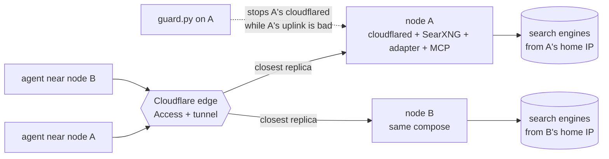

# Search cluster: one hostname, several home machines

Several machines on different home connections serve the same search hostname. A request
goes to the closest one that is up, and nobody changes a URL when a machine sleeps, moves
or loses its wifi.



## How it works

- **One tunnel, N replicas.** Every node runs the same `docker-compose.yaml` and the same
  tunnel token. Cloudflare forwards each request to the geographically closest connected
  replica and retries another if that connection fails
  ([Tunnel availability](https://developers.cloudflare.com/cloudflare-one/networks/connectors/cloudflare-tunnel/configure-tunnels/tunnel-availability/)).
  The ingress names `http://tavily-adapter:8000` and `http://searxng-mcp:8000` resolve on
  every node because the container names are the same.
- **The MCP server is stateless** (`stateless_http=True`), so any node answers any request
  and nothing is sticky.
- **Replicas do no health steering.** A node that is connected but slow (a laptop on bad
  wifi) still gets the traffic near it. `guard.py` closes that gap from the node's side:
  after 3 slow checks it stops its own `cloudflared`, only while another replica is
  connected, and starts it again after 3 good checks or when it is the last one left.
  It also restarts `cloudflared` when the container runs but holds no tunnel connection
  for two checks: a network switch (VPN on/off, new wifi) left it like that for minutes.
  It reads that from cloudflared's `/ready`, so publish the metrics port on the node:
  `127.0.0.1:8081:8081` (`node.override.yaml` already does).
- **Each node searches from its own IP.** Engine captchas and suspensions are per node.
  Run nodes on residential connections: datacenter ranges get captchas on the first queries.

Not used, on purpose: Cloudflare Load Balancing (steers by measured latency and health, but
needs a tunnel per node and is a paid add-on) and a Worker in front (another moving part).
Move to a load balancer when guard-style self-eviction is no longer enough.

## Add a node

On the node (Linux or macOS with Docker, compose >= 2.24):

```bash
git clone https://github.com/fortunto2/searxng-docker-tavily-adapter && cd searxng-docker-tavily-adapter
```

From the main node, give it a config without your engine credentials and the tunnel token:

```bash
python3 cluster/render-node-config.py config.yaml | ssh NODE 'cat > searxng-docker-tavily-adapter/config.yaml'
printf '%s' "$TUNNEL_TOKEN" | ssh NODE 'cd searxng-docker-tavily-adapter && cluster/node-up.sh'
```

`render-node-config.py` writes a fresh `server.secret_key` and disables every engine that
needs a credential (it lists them in the first line). `node-up.sh` keeps the token in
`cluster/node.env` (mode 600, gitignored), binds the local ports to 127.0.0.1 only (Docker
bypasses the host firewall), starts the five services and waits for `/health`.

Check that the tunnel sees it: the tunnel's page in Zero Trust lists one connector per
node, or `guard.py status` prints `replicas_now`.

## Guard (nodes on unreliable networks)

```bash
SEARCH_GUARD_KEYCHAIN=<keychain item with a Cloudflare API token that reads tunnels> \
  python3 cluster/guard.py install     # launchd agent, a check every 60 s
python3 cluster/guard.py status        # streaks, last probe, connected replicas, last moves
python3 cluster/guard.py uninstall
```

State and the move log live in `~/.local/state/search-guard/`. Thresholds:
`SEARCH_GUARD_SLOW` (1.5 s for one HTTPS request; a healthy line answers in 0.2-0.5 s) and
`SEARCH_GUARD_N` (3 checks in a row). A container stopped by hand is left alone.

## Remove a node

`docker compose -f docker-compose.yaml -f cluster/node.override.yaml down` on it. The
others carry on; nothing to change in Cloudflare.
